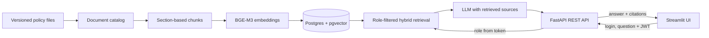

# 🧭 PolicyPilot — Role-aware RAG for Internal Knowledge

[](https://github.com/alels001/policy-pilot/actions/workflows/ci.yml)
[](https://github.com/alels001/policy-pilot/actions/workflows/docker.yml)

A small, local-first **retrieval-augmented generation (RAG)** project for answering employees' questions from internal HR, IT, compliance, and quality documents. Answers are grounded in retrieved passages and show their sources.

> **Portfolio/demo project.** Nordwerk Automotive GmbH is a fictional company, and the sample documents and users are synthetic. Users sign in through the API with a shared **demo password**; the role always comes from a signed JWT. A real rollout would use the company SSO.

## What it demonstrates

- **Document ingestion:** catalog-based version selection, section-aware Markdown chunking, and multilingual embeddings.
- **Role-aware search:** filter candidates by `allowed_roles` in PostgreSQL **before** they are returned.
- **Hybrid retrieval:** vector similarity with pgvector + PostgreSQL full-text search, combined using reciprocal-rank fusion.
- **Grounded answers:** use retrieved excerpts as context, cite documents, and decline to answer when evidence is insufficient.
- **REST API with login:** FastAPI with JWT tokens. The role is taken only from the token, never from the client.
- **Thin UI:** Streamlit chat that talks only to the API and never decides roles itself.
- **Containers:** one Docker image for API and UI, started together with the database by Docker Compose.
- **CI/CD:** GitHub Actions runs ruff and 53 tests against a real PostgreSQL/pgvector database on every pull request, and builds the Docker image; on `main` it publishes the image to GitHub Container Registry.
- **Evaluation:** a labelled question set covering answerable, restricted, cross-lingual, and out-of-scope questions.

## Architecture



| Component | Implementation |
|---|---|
| Document corpus | Synthetic Markdown policies and `data/catalog.yaml` |
| Vector index | PostgreSQL 17, pgvector, HNSW cosine index |
| Embeddings | `BAAI/bge-m3` (1024-dimensional, local SentenceTransformer) |
| Keyword search | PostgreSQL `tsvector` / GIN |
| Access filter | `allowed_roles` on each chunk, enforced in retrieval SQL |
| Answer generation | OpenAI API with cited context and no-answer behaviour |
| API | FastAPI, JWT (HS256, 60 min), Pydantic request validation |
| Interface | Streamlit |
| Containers | Docker image built with uv (CPU-only PyTorch), Docker Compose for database, API and UI |

## Run with Docker (recommended)

Prerequisites: Docker and an OpenAI API key.

```bash
git clone https://github.com/alels001/policy-pilot.git
cd policy-pilot

cp .env.example .env
# Fill in .env: OPENAI_API_KEY, POSTGRES_PASSWORD, JWT_SECRET and DEMO_PASSWORD
# A good JWT_SECRET: openssl rand -hex 32

# Build the image and start database, API and UI
docker compose up -d --build

# First run only: build the vector index from the synthetic documents
docker compose run --rm api python -m policy_pilot.ingest
```

Open **http://localhost:8501**, choose a demo user and sign in with your `DEMO_PASSWORD`. The interactive API docs are at **http://localhost:8000/docs**.

The first start downloads the embedding model (about 2 GB) into a Docker volume, so it can take several minutes. Later starts are fast.

```bash
docker compose ps          # status of the three services
docker compose logs api    # API logs
docker compose down        # stop everything (data and model stay in volumes)
```

## Run locally (for development)

Prerequisites: **Python 3.12+**, [uv](https://docs.astral.sh/uv/), Docker, and an OpenAI API key.

```bash
cp .env.example .env       # fill in the values as above

docker compose up -d db    # only the database
uv sync
uv run python -m policy_pilot.ingest
```

Then start the API and the UI in two terminals:

```bash
uv run uvicorn policy_pilot.api:app --reload
```

```bash
uv run streamlit run src/policy_pilot/app.py
```

Running the answer-generation stage requires API usage and may incur charges.

### Evaluation and tests

```bash
# Retrieval evaluation: no OpenAI calls
uv run python -m policy_pilot.evaluate retrieval

# Full answer evaluation: uses the LLM API
uv run python -m policy_pilot.evaluate answers

# Unit and API tests; the access-control tests need the indexed database
uv run pytest
```

The labelled cases live in [`eval/golden_set.yaml`](eval/golden_set.yaml), with example result CSVs in [`eval/`](eval/). Current result on the synthetic set: 25 of 28 cases correct, 0 confidential leaks. These are **not** production benchmarks.

## API

| Method | Endpoint | Purpose |
|---|---|---|
| GET | `/health` | Liveness check (used by the Docker health check) |
| POST | `/login` | Demo user + password → JWT access token |
| GET | `/me` | Name and role of the signed-in user |
| GET | `/access` | Number of documents per department the user may see (no titles) |
| POST | `/ask` | Question → grounded answer with sources, filtered by the role in the token |

## Sample questions

- *Wie viele Urlaubstage habe ich?* — Employee / general HR policy
- *What should I do after clicking a phishing link?* — IT guidance
- *What is the salary band for a Senior Engineer?* — HR Specialist only
- *Welche Abweichungen wurden im internen Audit festgestellt?* — Quality Engineer only

The retrieval layer should not expose confidential document chunks to roles that lack access.

## Project structure

```text
data/                 synthetic policies, catalog and demo users
db/                   PostgreSQL schema and vector indexes
src/policy_pilot/
  config.py           settings from environment variables
  catalog.py          versions, validity and permissions
  chunking.py         section-aware chunks
  embeddings.py       multilingual embeddings
  ingest.py           catalog -> chunks -> database
  retrieval.py        role-filtered hybrid search
  generation.py       grounded answer generation
  auth.py             JWT tokens; the role comes only from the token
  api.py              FastAPI REST API
  client.py           HTTP client used by the UI
  app.py              Streamlit UI (talks only to the API)
  evaluate.py         evaluation scripts
eval/                 labelled questions and example results
tests/                catalog, chunking, access-control and API tests
docs/                 requirements and design decisions
Dockerfile            one image for API and UI
docker-compose.yml    database, API and UI
.github/workflows/    CI (lint + tests) and Docker image build
```

## Limitations and next steps

This is a **local pilot**, not an enterprise deployment. The demo users share one password, which is fine for a demo but not for real use. A real rollout would require SSO with trusted role mapping, secret management, operations monitoring, and a security review. The synthetic corpus is intentionally small; results should not be generalized to an organization's document collection.

Next steps: conversation memory for follow-up questions (agent with LangGraph), deployment to AWS, and tracing of answers and costs.

Read more in the [product requirements](docs/PRD.md).

---

Built by [Ali Elshafey](https://github.com/alels001) as a practical project exploring secure, useful enterprise search.