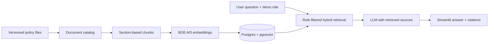

# 🧭 PolicyPilot — Role-aware RAG for Internal Knowledge

A small, local-first **retrieval-augmented generation (RAG)** project for answering employees' questions from internal HR, IT, compliance, and quality documents. Answers are grounded in retrieved passages and show their sources.

> **Portfolio/demo project.** Nordwerk Automotive GmbH is a fictional company, and the sample documents and users are synthetic. The current Streamlit app uses a **demo user selector**, not production authentication.

## What it demonstrates

- **Document ingestion:** catalog-based version selection, section-aware Markdown chunking, and multilingual embeddings.
- **Role-aware search:** filter candidates by `allowed_roles` in PostgreSQL **before** they are returned.
- **Hybrid retrieval:** vector similarity with pgvector + PostgreSQL full-text search, combined using reciprocal-rank fusion.
- **Grounded answers:** use retrieved excerpts as context, cite documents, and decline to answer when evidence is insufficient.
- **Demo UI:** Streamlit chat with example questions and visible document access by user role.
- **Evaluation:** a labelled question set covering answerable, restricted, cross-lingual, and out-of-scope questions.

## Architecture



| Component | Implementation |
|---|---|
| Document corpus | Synthetic Markdown policies and `data/catalog.yaml` |
| Vector index | PostgreSQL 17, pgvector, HNSW cosine index |
| Embeddings | `BAAI/bge-m3` (1024-dimensional, local SentenceTransformer) |
| Keyword search | PostgreSQL `tsvector` / GIN |
| Access filter | `allowed_roles` on each chunk, enforced in retrieval SQL |
| Answer generation | OpenAI API with cited context and no-answer behaviour |
| Interface | Streamlit |
| Local services | Docker Compose for PostgreSQL |

## Run locally

Prerequisites: **Python 3.12+**, [uv](https://docs.astral.sh/uv/), Docker, and an OpenAI API key for generated answers.

```bash
git clone https://github.com/alels001/policy-pilot.git
cd policy-pilot

cp .env.example .env
# Set OPENAI_API_KEY in .env and choose a local POSTGRES_PASSWORD

docker compose up -d
uv sync

# Prepare the vector index from the synthetic policy documents
uv run python -m policy_pilot.ingest

# Launch the local demo
uv run streamlit run src/policy_pilot/app.py
```

On first use the embedding model is downloaded. Running the answer-generation stage requires API usage and may incur charges.

### Evaluation and tests

```bash
# Retrieval evaluation: no OpenAI calls
uv run python -m policy_pilot.evaluate retrieval

# Full answer evaluation: uses the LLM API
uv run python -m policy_pilot.evaluate answers

# Unit tests; the access-control integration test needs the indexed database
uv run pytest
```

The labelled cases live in [`eval/golden_set.yaml`](eval/golden_set.yaml), with example result CSVs in [`eval/`](eval/). These are results on the synthetic test set, **not** production benchmarks.

## Sample questions

- *Wie viele Urlaubstage habe ich?* — Employee / general HR policy
- *What should I do after clicking a phishing link?* — IT guidance
- *What is the salary band for a Senior Engineer?* — HR Specialist only
- *Welche Abweichungen wurden im internen Audit festgestellt?* — Quality Engineer only

The retrieval layer should not expose confidential document chunks to roles that lack access.

## Project structure

```text
data/                 synthetic policies, catalog and demo users
db/                   PostgreSQL schema and vector indexes
src/policy_pilot/
  catalog.py          versions, validity and permissions
  chunking.py         section-aware chunks
  embeddings.py       multilingual embeddings
  ingest.py           catalog -> chunks -> database
  retrieval.py        role-filtered hybrid search
  generation.py       grounded answer generation
  app.py              Streamlit demo
  evaluate.py         evaluation scripts
eval/                 labelled questions and example results
tests/                catalog, chunking and access-control tests
docs/                 requirements and design decisions
```

## Limitations and next steps

This is a **local pilot**, not an enterprise deployment. The demo role dropdown is convenient for testing but **must never be treated as secure login**. A real rollout would require authentication/SSO, trusted role mapping, deployment controls, operations monitoring, and security review. The synthetic corpus is intentionally small; results should not be generalized to an organization's document collection.

Read more in the [product requirements](docs/PRD.md).

---

Built by [Ali Elshafey](https://github.com/alels001) as a practical project exploring secure, useful enterprise search.
